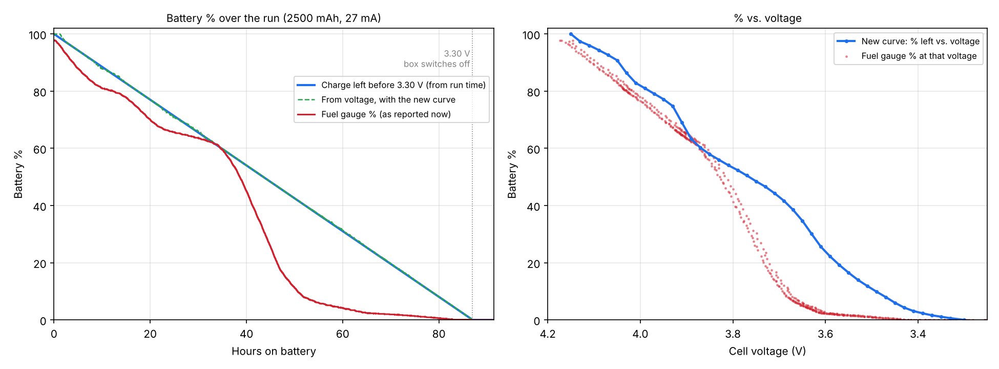
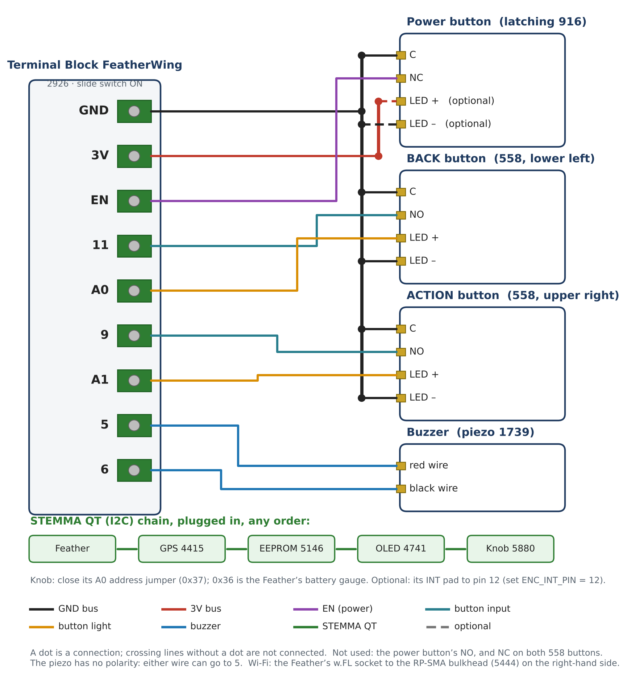
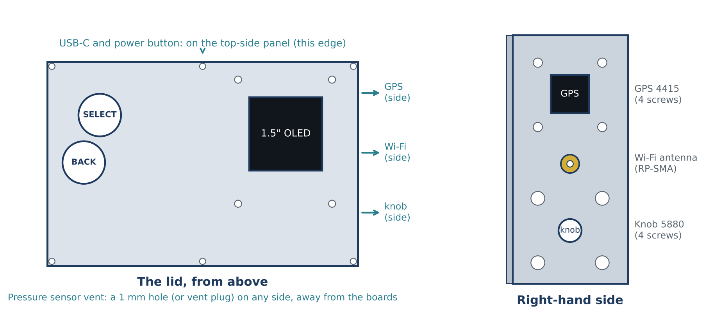

# Aspect Wave Life Logger™
### ▶ [Try the system demo](https://sscopazzi.github.io/Life_Logger/)
The demo requires no hardware and no sign-up. It runs in your browser with auto-filled made-up data and any changes you make stay in that browser.

---

### ▶ [Buy the system here](https://aspectwave.io/)

Everything I design and sell is **100% open source**; this means, if you would like, you can order the parts yourself and build your own! If you would instead prefer to purchase a ready-built system, you can do so from my website above.

---

### Life Logger is a small physical box that keeps your daily checklist, work orders, calendar, notes, contacts, time, money and location track organized and logged. And it keeps all of it completely to itself with zero outside access to your data.

The demo above is a website so you can try it. The real Life Logger is not a website. It is a battery-powered box in a machined aluminum case, with its own screen, two lit buttons and a knob. It makes its own Wi-Fi hotspot and serves its dashboard to your phone or laptop over that hotspot (or by passthrough with your home Wi-Fi).

- **Standalone.** No account, no cloud, no app, no subscription and no outside servers. Everything is stored on the box and its SD card. It works with no internet at all. Backup feature to export all your data so you can safely restore after loss.
- **Private.** Nobody can see your data unless you give them the device's password and let them connect.
- **Portable.** Built for life on the go: take it to sea, on vacation, bring it home, to work, and it picks up where it left off.

If you give the box your home Wi-Fi, it uses that only to set its clock and to be reachable at http://lifelogger.local when it's in range of your Wi-Fi, so you don't have to connect directly to the box when you're at home. The only outside requests are the map tiles on the Map tab (street, satellite or topo). Your own phone or laptop fetches them when that device has internet; without internet, the track and your saved spots are drawn on a plain grid.

## The dashboard

The tabs are grouped by what you're doing: **Today**, **Upkeep**, **Business & money** and **Out & about**, with Settings at the right. Rename the groups, drag tabs between them, hide what you don't use, and set the divider's width and color in Settings.

On a phone the same dashboard is laid out like an app: a bottom bar (Today, Notes, Upkeep, Out, More) whose groups pop up their tabs, a round **+** for the tab's main add (hold it for everything else), the tab's other buttons under **⋯**, and table rows as cards. A phone opens on the Checklist; a computer and a phone each keep their own start tab.

Everywhere:
- **Search everything** (🔍, or press `/`): work orders, jobs, invoices, clients, vendors, notes, people, assets, stock, events, time and spots in one box.
- **Quick add** (the ▾ next to the big button at the top right): a note, event, purchase with a receipt photo, the job timer, a person or a spot, from any tab. The big button itself is your pick (work order, note, event, purchase, job timer, person or spot) in Settings › Dashboard Display.
- **Times your way:** 24 h or am/pm everywhere. Type a time without the colon: `1600`, `930`, `4:30p`, or decimal hours (`16.1` is 16:06), and Tab on.
- **Undo and redo:** Ctrl+Z / Ctrl+Y undo and redo saved changes; the last five are listed too.
- **Lists that drop down, and suggestions as you type:** every category, group, vendor, place, person and project box shows its whole list as soon as you click or tab into it, and remembers what you've used ("ada" and Tab fills in "Adafruit"); a new name offers "+ New …" there and then. Tabbing through an empty box leaves it empty. Settings › Saved lists shows every list to add to or tidy up.
- **Help where you need it:** each card's **?** shows its instructions; they stay hidden until you ask.
- **Everything links up:** people, clients and vendors are one address book. A client's or vendor's contact person is a People entry; rent, leases and loans can be with a person, client or vendor; and each one's page lists what it's linked to (work orders, notes, events, documents, money owed, assets and stock bought from them).
- **Moving in:** first setup has a page for your details (name in First / Middle / Last, address, home Wi-Fi, business) and for bringing in files from the apps you're leaving: Google Takeout (Keep, Maps, Contacts, Calendar in one .zip), the phone's Maps Timeline, iPhone / Android / Outlook / any vCard or CSV contacts, Apple or Outlook calendars, Clockify, and another Life Logger's work orders or backup. Each has its own how-to, and it's all under Settings › Storage › Your details and files later.

| | |
|---|---|
| **Checklist** | Nested items you can drag to reorder. Ticking an item ticks everything under it, on the web page and on the box. Items can link to work-order steps. Archive a day, then rename, edit or delete it later. Holds about 750 to 850 items: a line under the list shows how full it is, and at 90% **Archive and clear ticked** saves the whole list to the archive and takes the ticked items off. |
| **Time** | A start / pause / stop job timer (Clockify-style) by job or by your own projects (development, admin…). One list for the dates you pick (this month, last month, …), every line typed into in place, with billable time going straight onto an invoice. Pin projects to the box's JOB TIMER screen to start and stop them with the knob, or start / pause the last one with the box's ACTION (a press of the knob). **Import from Clockify** reads its projects export (CSV) once, so you can move over. |
| **Calendar** | Day view, one to four months, or a list. Your events (multi-day and repeating), work orders, routine dates, subscriptions, bills, card due dates, rent and loan payments, warranty and calibration dates. Search by title, place or notes. Imports and exports `.ics` (Google Calendar), and an import can be taken back out in one go. **Planner** (a tab inside Calendar) is a scratchpad for a leave or a trip, kept off the calendar: days left to right in rows (Where, Travel, People, Plans, Appointments, Other), painted by pressing and sliding; overlaps stack; 🔒 locks a block. A block's name grows to fill the block, with its people and notes under it. A block's details have the calendar's event fields (times, repeats, color, reminder, place), and a block can hold timed events of its own; Enter or a click outside closes them. Options A, B, C… to compare, with days away, nights, free days and costs under each; send the ★ one to the calendar and the plan goes to an archive. Plans swap between boxes as `.llplan` files. A day counter up top counts the days between two dates. |
| **Notes** | You write in the formatted view: bold, italic, underline, strikethrough, headings, lists, tick boxes and left / center / right / justified paragraphs, with a word count. Pin notes, show one on the box's screen, color-code them, and file them under categories with `#word` or `#[two words]`. Link a note to a work order, routine, asset or event; set a reminder; send its lines to the checklist. Archive, search, go back to an earlier version, or save it as a Word or PDF file. Imports Google Keep. |
| **People** | Your contacts: First / Middle / Last name (or just an organization), phones, emails, address and map position, organization, tags, color and notes. Sort by first or last name, organization, newest or color. Each person shows what they're linked to: the clients and vendors they're the contact for, money owed and rent, documents, events, work orders and notes. Imports Google, iPhone, Android and Outlook contacts (vCard or CSV); exports `.vcf`. |
| **Work Orders** | Overdue, due-soon, open and recently finished work orders, with reminders for bills, credit cards, rent, expiring documents, calibrations, low stock and backups. One-off, routine and business jobs, each with description, steps, findings, previous findings, parts and cost, people and time, attachments, and a full log. Start a job timer from any open work order. Settings arranges the four columns in the order you like. |
| **Assets** | **Assets** (car, water heater, instruments… with year, make and model, manuals, warranties, calibration dates, meters and service history; warranty and calibration can be n/a, and calibration starts n/a. Things with a fixed expiry date, like an extinguisher or road flares, get **Expires** with reminders, and **Replaced…** takes the new one's date, keeps the old one in its history and logs a completed work order. Mark an asset as business equipment with its business share and in-service date) and **Stock** (parts on the shelf by category, with a low-stock list: receive them and they go into Spending once; type a part's name on a work order to use one; a warning at the last one, because one is none). |
| **Expiring** | Licenses, certifications, passports and insurance with your own reminder schedule, plus asset warranties, instrument calibrations and asset expiry dates. |
| **Jobs** | For paid work: **clients**, **proposals** (steps priced flat, hourly or each, terms, an optional deposit), **invoices** (the same layout, tax, discount, payments, paid deposits credited automatically), and the **jobs** themselves. Save any proposal or invoice as a PDF or Word file with your logo. |
| **Money** | Spreadsheet-style **Balances** (type what each account shows; it gives you **Available**; tick which accounts are savings), **Projection** (Available carried forward month by month, with charts including your savings balance; a blank line at the top of every month to type into), **Owed** (loans and IOUs both ways) and **Rent & Lease** (rent you pay or collect). Every line is typed straight into the table, and owed and rent items can be linked to a person, client or vendor. |
| **Purchasing** | Spending by color-coded category: type a purchase into the first line, attach a receipt photo (the phone's camera), tick the categories that are business, or tick a purchase (or a receipt line) as business with its share. **Read a PDF** brings in an Adafruit, DigiKey or Amazon receipt: its parts go into Stock or Assets and Spending, shipping, tariff and tax as their own line (shared out by the business share), and the PDF is kept. Subscriptions and bills (autopay, with a warning when the card paying them is about to expire), vendors (laid out like People, with a contact person, receipts, purchases, and the assets and stock bought from them) and **Receipts**, every receipt on the box in one searchable list. |
| **Reports** | Any date range: net worth, what you have and owe, spending, work orders, time worked by project and job, business mileage at the IRS rate for each trip's date, and a **business summary** (income by client, business expenses and equipment, mileage, net, hours) that becomes your year-end summary. Business, personal or both, with ready-made picks (year-end business, year-end personal, this year so far), by calendar year or your business's tax year. Save as a PDF file or export CSV. |
| **Map** | Where the box has been while it had a GPS fix, each day as its own layer, over a street, satellite or topo map. **Trips** found in the track (or typed in): tick Business, add a purpose, and they add up in Reports. Trips that start or end at home are named Home. Saved spots with notes, pins, colors and lists; import Google Maps places and Timeline (from Google Takeout or the phone's Timeline export); export GPX and KML. |
| **Weather** | Inside and outside temperature and humidity from small wireless sensor nodes (ESP-NOW), which you can rename, the box's own pressure track (mmHg, hPa or inHg) with its 3-hour change, and a **Box** series when a temperature and humidity sensor is fitted inside. Gaps stay gaps; nothing is filled in. |
| **Settings** | Wi-Fi (the hotspot can turn off at home; the box's network name), clock (24 h or am/pm; set by the internet and GPS, or by hand from the dashboard or the box), box password, business and personal info (addresses in the usual shipping-form fields, and which one is home), saved lists, storage, dashboard display (light or dark, calendar day numbers, tabs and their groups), routine groups and schedule (every so many days, months or years; nine groups come ready-made), backups (with every attachment, or only the new ones) and the full searchable history. Choose the box's screens and their order, the lines and units on its LIFE LOGGER and MAP screens, the shortcuts and the quick menu's rows, the GPS track's detail, the work-trip prompt and how often climate is logged. **Pin mapping**, **Add-ons** and **Indicator lights** set up the box's hardware (below). |

## The physical box

- **Controller:** Adafruit ESP32-S2 Feather with w.FL (6282), with its Wi-Fi on an external antenna.
- **Case:** machined aluminum. On the lid: the two buttons at the left (BACK lower left, SELECT upper right) and the screen at the top right. The GPS, the Wi-Fi antenna (RP-SMA) and the knob are on the right-hand side, top to bottom; the USB-C port and the power switch are on the top side.
- **Screen:** 128×128 grayscale OLED (Adafruit 4741). The home screen, LIFE LOGGER, shows your pick of status lines (time, Wi-Fi, GPS, battery and time left, box temperature, climate…), any timers and alarms, and a menu of the other screens in the order you choose: CHECKLIST, TODAY, NOTES, WORK ORDERS, JOB TIMER (your pinned projects and active jobs, to start, pause, stop or switch), EXPIRING, MAP (speed, distance, position, and a compass rose with your course while moving), your BUSINESS and PERSONAL cards (to hold up when someone asks for your details), SUN & MOON (sunrise, sunset, daylight, civil and nautical twilight, solar noon and how high the sun gets, the moon's phase, % lit, rise and set, and the next full or new moon, worked out on the box from the GPS or its last fix), BAROGRAPH (the pressure, its 3-hour change with the shipping-forecast word, and a graph: turn the knob for 24 h, 48 h or 7 days), JOIN (how to connect, and which phones and computers have the dashboard open) and CLOCK (day, time and date in big segment digits like a Casio watch, with the battery % and volts; A or P in 12-hour time). Long lines wrap with a hyphen; a highlighted line too long for the screen slides sideways.
- **Controls:**
  - a clicking rotary knob (Adafruit 5880) that moves one row per click;
  - **SELECT**, the upper-right lit button: opens the screen picked in the menu, ticks a checklist item, opens a note, work order or event, starts / pauses / stops the job timer, or on MAP starts a **Work trip** (tick it in the driveway: it counts the distance until you press End trip, then goes to the dashboard as a business trip; a long red light doesn't end it, and after an hour parked it beeps and asks whether you're still on it) or saves a spot. Hold it 1.5 s to turn the screen off;
  - **BACK**, the lower-left lit button: back one step (an open note or work order to its list, then to LIFE LOGGER). Hold it and turn the knob to set the screen's brightness;
  - **ACTION**, pressing the knob in: runs a shortcut you pick in Settings › The box's screen (out of the box: job timer start / pause). **Hold the knob in for the quick menu**: it opens on Close and stays open; turn to a row and press the knob (or SELECT) to run it, or BACK to close it. The rows are yours to pick and order: screen off, GPS on / off, job timer, work trip start / end, quick mark (saves a spot), BNWAS on / off, find my phone, clock, home, set clock, hotspot on, test alert, alerts (sound / vibrate / both), restart;
  - **BACK + SELECT held 3 s:** a third shortcut (out of the box: **find my phone**, which makes every phone and computer with the dashboard open sound and flash until tapped);
  - any button or the knob stops a ringing timer or alarm. The buttons' lights follow the screen's brightness and glow dim while it sleeps; when you tick, start or save something only the button you used blinks. Settings › The box can turn them off.
- **Buzzer and vibration:** a piezo (Adafruit 1739) and a vibration motor (DRV2605L 2305 + motor disc 1201) for kitchen timers, "find my box", and a BNWAS-style move reminder that sounds every few minutes until you walk over and press a button (put it in the other room and force yourself to stand up and walk every x minutes). Alerts sound, vibrate or both (Settings › The box); find my box always sounds.
- **Pressure:** a BMP388 (Adafruit 3966) inside the box, read every minute; the 10-minute average goes in its own track. The case needs a 1 mm vent (or a vent plug) so the inside follows the weather; the sensor's temperature is only ever shown as "inside the box".
- **Pin mapping** (Settings): which pin each part is on: BACK and SELECT and their lights, the buzzer, up to four extra buttons (each runs a quick-menu action) and two indicator lights, on the Feather's pins or a PCF8574 or AW9523 expander. Lights dim on Feather and AW9523 pins; a PCF8574 only switches them on and off, and Settings warns you. A live dot shows each button as it's pressed, and **Test lights** blinks each light in turn.
- **Add-ons** (Settings): **Scan** finds the I2C parts on the chain, each with what it's for and a live reading, and you tick the ones to use. Pressure: BMP388/390, DPS310, BME280, BMP280, LPS22 or LPS22DF. Box temperature and humidity: SHT3x, SHT4x, AHT20 or BME280. Light: TSL2591 or BH1750 (the VEML7700 can't be used: its only address, 0x10, is the GPS's). Movement: an LSM6DS or BNO085 wakes the screen when you pick the box up and turns the screen to match how you hold it. The BH1750 and PCF8574 report no ID, so you pick their addresses yourself.
- **Indicator lights** (optional): two LEDs, light 1 blue and light 2 red, anywhere on the case. Each shows up to three states (work trip, job timer running or paused, GPS on, fix or no fix, low battery, charging, no SD card, clock not set, hotspot on, on or away from the house Wi-Fi), each solid, slow blink, fast blink or a blip; the first one that's true wins. They can follow the screen's brightness and go out while it sleeps.
- **Also inside:** GPS, a real-time clock and an SD card, all running on battery, and a two-resistor USB sense so the box knows when it is plugged in.
- **GPS power:** the GPS sleeps while the box is on your home Wi-Fi and is on everywhere else; the quick menu turns it on or off by hand until the box restarts, and a work trip keeps it on. The Map's on / off list shows how long it slept, so a gap in the track says why it's there.
- **Battery %:** worked out from the cell's voltage on a discharge curve measured over a 4-day run on a 2,500 mAh LiPo, as the charge left before the box switches itself off (the fuel gauge's own % was far off: 12 % at 3.70 V with 43 % still to go). Time left comes from how fast that % has fallen over up to the last 6 hours, after a first hour of "measuring". On USB it shows "USB" and no %. 
- **Low battery:** below 3.30 V (and not on USB) the box saves everything and switches itself off, before the battery sags far enough to upset the SD card mid-write. It stays off until you charge it and slide the power switch off and on.
- **Write safety:** every line of the log carries its own checksum. At start-up the box checks each one; a line cut short by a power cut or damaged on the card is set aside in `log.bad` (Settings › Storage says how many) and the rest carries on. Files that get rewritten (settings, the checklist, notes) are written whole to a temporary file first and swapped in, so a power cut leaves the old version or the new one, never half of one.
- **Storage:** everything lives on the SD card. The box's own flash keeps the dashboard, checklist, notes and settings, and a copy of the log while it fits, so the box keeps working with the card out and the card catches up when it's back. Once the log outgrows flash (years of use), the box needs its card to save.

## Updating a box

Updates are a single `.lbk` file (the dashboard and the firmware together), e.g. `Life_Logger_v2.3.lbk` (in `.lbk_files/`). Upload it in **Settings › Firmware** with the box password; the box restarts and the page reloads.

**All future firmware updates are 100% free** and will be released on this GitHub page.

## Building from source

The **Assembly & Wiring Guide**, **User Manual**, **Quick Start** and **Datasheet** are in `docs/` as PDFs, with the demo (`docs/index.html`, the page the demo link opens). The case's SolidWorks files are in `solidworks/`, and the bill of materials as a spreadsheet is `hardware/Life_Logger_BOM.csv`. The PDFs show the box's out-of-the-box pins; Settings › Pin mapping can move any of them.





- **Sketch:** `life_logger/life_logger.ino`, with `life_logger/clock_glyphs.h` (the CLOCK screen's digits), `life_logger/astro.h` (sun and moon) and `life_logger/partitions.csv` beside it (the house sensor nodes: `life_logger_node/life_logger_node.ino`)
- **Antenna:** the Feather's w.FL socket to an RP-SMA bulkhead (Adafruit 5444) and a 2.4 GHz antenna (944). It is w.FL (MHF3), not u.FL.
- **Pins (out of the box; Settings › Pin mapping changes them):** BACK button pin 11 (its light A0), SELECT button pin 9 (its light A1), power switch (SS12F15 slide, SPDT): middle pin to EN, one end pin to GND, piezo across pins 5 and 6, USB sense: the Feather's USB pin through 100 kΩ to A2 and 100 kΩ from A2 to GND; the GPS, EEPROM, screen, knob, BMP388 (0x77) and DRV2605L (0x5A) are on the STEMMA QT (I2C) chain (knob at 0x37: close its A0 jumper).
- **Arduino ESP32 core:** 3.3.x (the published `.lbk` is built with 3.3.12)
- **Board:** `esp32:esp32:adafruit_feather_esp32s2`
- **Partitions:** `life_logger/partitions.csv` (two 1.5 MB app slots, so `.lbk` updates can be written beside the running firmware, and 896 KB of flash storage) is used whatever the menu says. In the Arduino IDE pick **Tools › Partition Scheme › Minimal SPIFFS (1.9MB APP with OTA)** only so the size check allows more than 1.25 MB; the real limit is 1,572,864 bytes (2.3 is about 1,423,000). Flashing it over USB the first time erases the box's flash storage.
- **Libraries:** RTClib, Adafruit MAX1704X, Adafruit LC709203F, Adafruit BusIO, Adafruit SSD1327, Adafruit GFX, Adafruit seesaw, Adafruit BMP3XX (and the Adafruit Unified Sensor it asks for), Adafruit DRV2605, ArduinoJson 7.x (the versions the published `.lbk` is built with are in `THIRD_PARTY_NOTICES.md`). The add-on sensors in Settings › Add-ons need no libraries of their own.
- **Generated file:** `life_logger/clock_glyphs.h` (and the demo's `docs/demo/clock_glyphs.js`) are drawn by `tools/clock_glyphs.py` (needs Pillow); change the script and run it rather than editing them.

- **First install:** flash the sketch over USB. The box then has no dashboard yet: join its hotspot, open http://192.168.4.1 and upload the `.lbk` from `.lbk_files/` on the page it shows.

### The dashboard's source

The dashboard is one file, `dashboard/dashboard.html` (HTML, CSS and JavaScript, no frameworks or build system). The box keeps it in flash, apart from the firmware, so it can be changed without recompiling:

- **Trying changes:** copy `dashboard.html` to the SD card as `/www/index.html`. While that file is there the box serves it instead of its own; delete it to go back.
- **Making an update file:** shrink it, then pack it with the firmware build (`life_logger.ino.bin`, from Sketch › Export Compiled Binary):
  ```
  npm install terser
  node tools/minify.js dashboard/dashboard.html dashboard_built.html
  python3 tools/make_lbk.py dashboard_built.html life_logger.ino.bin Life_Logger_v2.3.lbk 2.3
  ```
  A `.lbk` is a one-line header, the gzipped dashboard and the firmware; the box checks the firmware fits its 1.5 MB slot before writing it.

### The demo's source

`docs/index.html` is built from the minified dashboard and the files in `docs/demo/`: `demo_hub.js` (a pretend box that answers the dashboard's calls and keeps changes in the browser), `demo_box.js` (the box, its screen and its controls) and `seed.json` (the made-up data):

```
node tools/minify.js dashboard/dashboard.html dashboard_built.html
python3 docs/demo/build_demo.py dashboard_built.html
```

It reads the box's 5×7 font from the Adafruit GFX library (`glcdfont.c`) in your Arduino libraries folder, or from `--gfx path/to/glcdfont.c`.

Nothing personal is compiled in. A new box starts with a public hotspot ("Life Logger", password shown on its JOIN screen); on first boot it asks for its own box password, your own hotspot password, (optionally) your home Wi-Fi, and its time zone, which starts as your phone's.

## Credits and licenses

Designed by Sophie Scopazzi, Aspect Wave LLC, with Claude (Anthropic).

- Hardware design (the case, bill of materials, wiring and assembly guide): CERN-OHL-S-2.0
- Firmware, dashboard, demo and tools: GPL-3.0-or-later
- Documentation and data: CC BY-SA 4.0

Each file's license is in its SPDX header or in `REUSE.toml`. The full texts are in `LICENSES/`, with an overview in `LICENSE`. The hardware's editable sources are listed in `hardware/README.md`. Third-party code (Adafruit libraries, ArduinoJson, the Espressif ESP32 core, and Leaflet and the map tiles loaded at run time): `THIRD_PARTY_NOTICES.md`.

"Aspect Wave", "Aspect Wave Life Logger" and the logo are trademarks of Aspect Wave LLC: see `TRADEMARKS.md`. If you build your own unit, you're welcome to say it's based on the Aspect Wave Life Logger. If you distribute one, give it your own name.

Contributions: see `CONTRIBUTING.md`.

---

Made by Aspect Wave LLC - [Website](https://aspectwave.io/)
